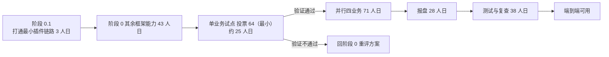

# 港股通（HK Connect）四业务在 KGBP 的落地设计与工作量基线

**日期**：2026-11-11　**仓库**：`trade_trunk`（对照 `gt_trunk` / CTE 侧）
**权威正文**：`study/business_learning/hk_connect/` 六份文档（合计 3717 行，已提交并推送 `dev`，远程同步 `0 0`）
本文件是该系列的路由与结论摘要，细节与证据链以仓内文档为准。

## 1. 总体结论

1. **性质是「填插槽」，不是「改框架」**：KGBP 侧已预留四个港股通业务类型常量（61 转托管 / 62 公司行为 / 63 交易 / 64 投票），且**库名与 CTE 侧完全同名**（`libbiz_hk_*.so`），业务类型定义与加载约定不需要改。
2. **必须新增五件事**：功能号注册、消息结构（请求/应答/回报）、内存表、业务实现、报盘通道（深交所 DCOM 非交易）。
3. **工作主体在「框架适配」而非「业务规则」**：CTE 侧四个业务库合计约 29,793 行，按子任务实测，业务规则代码约占 30%，其余 70% 为框架能力调用与胶水。**主要风险是 KGBP 的框架能力缺口**，不是业务逻辑理解难度。
4. **KGBP 缺少 CTE 提供的一批关键框架能力**：持仓/资金冻结（`ShareRiskControl`/`FundRiskControlGeneral`）、费用引擎（`FeeHandler`/`FeeManagerNew`）、交易阶段闸门（`TradingPeriodManager`）、`rc::Checker` 抽象、DR 跨节点同步、FPGA/Ext 异步检查缓冲。需新建或寻找替代；**已确认「KGBP 侧没有」，但未确认是否存在替代实现或第三方库**——这是最大不确定性来源，命中任一项可整块扣减工时（如持仓冻结 6 人日、费用引擎 6 人日）。
5. **DCOM 非交易报盘是独立硬骨头**：KGBP 子树内无 DCOM 实现，能力落在 DYS/COS 侧。

## 2. 改变评估基线的实测事实（已用 md5 复核）

- **本仓库 `trade_trunk` 已含整套 DCOM 栈，且与 `gt_trunk` 逐字节相同**：`DYS-FRAMEWORK/cos_framework/itf/src/sz_dcom_opu.cpp`、`DYS-FRAMEWORK/cos_framework/itf/src/dcom/cos_tcp_handler.cpp`、`DYS-FRAMEWORK/cos_framework/business/src/codec_manager.cpp`、`DYS/cos_impl/src/business/dcom_hk_designation_base_codec.cpp` 四份 md5 一致。
  → 方案 A/B 的分歧**不是「能否拿到代码」，而是「代码在哪条链上运行、报文类体系归谁」**；早前「KGBP 侧完全无 DCOM」的表述过强，该能力本就落在 DYS/COS 侧而非 KGBP 子树。
- **DCOM 代码规模**：框架层约 1,736 行（`cos_framework` 侧含 dcom 的 14 条目 = 12 文件 + 2 目录，1585 行）+ 实现层约 4,148 行（`cos_impl` 侧 27 文件 / 5935 行，其中本范围约 3,764 行）。
- **KGBP 的 ATP 报文类体系远不齐（方案 B 的头号障碍）**：`kgbp_te.xml` 7,336 行但 `<Messages>` 段**只有 `PktHeader`**，`messages_kgbp_te.h` 仅 110 行，命名空间为 `kgbp.util`（CTE 为 `abf.util`）；对比 CTE `atp_te.xml` 19,711 行。
  → DCOM 编解码中的 `dynamic_cast<const PktHKDesignationTransferOrder&>` **必然失败 → 编出空串、静默丢单**。走方案 B **必须同时对齐报文类体系**，不能只打通数据通道。
- **CTE 侧四业务库规模（LOC 基线）**：`hk_stocks_through` 10371 行 / 25 cpp、`hk_designation_transfer` 8122 / 18、`hk_corporate_action` 5957 / 14、`hk_voting` 5343 / 12。
- **DCOM 业务编解码实现规模**：hk_designation cpp=422 / h=62 / test=269；hk_ca 455/63/264；hk_voting 359/62/167。

## 3. 工作量口径（以 `06_实现设计方案与工作量评估.md` §4.5 为准）

初版自上而下分解为 183 人日（阶段 0 地基 46 / 四业务 71 / 报盘 28 / 测试 38）。附录产出后按实测代码量重新折算：

| 工作线 | 实测基线 | 原估 | 细估 |
|---|---|---|---|
| 港股通转托管委托（业务模块侧） | 7,578 行 / 38 文件 + 单测 544 行 | 20 | **55.5**（其中 11.5 属阶段 0 共享项，真增量 ≈44） |
| DCOM 非交易报盘 | 框架层 ≈1,736 行 + 实现层 4,148 行（本范围 ≈3,764 行） | 12 | **方案 B（复用 DYS COS）56 / 方案 A（移植进 KGBP）85** |

- 总计：**口径一 251 人日（方案 B）/ 口径二 280 人日（方案 A）**；单人串行 12.5~14 个月，2 人并行 ≈7~8 个月。
- §4.5.2 显式列出 11.5 人日的重叠项，避免与阶段 0 重复计算。
- 估算方法：以 CTE 侧同功能实现行数为锚，按「移植改写 ≈ 行数 ÷ 90~110 行/人日」折算（A 口径整体约 44 行/人日，含改写、联调与验证）；方案 B 的第 15 项（8 人日，纯新增协议设计）是全表最大单点不确定项。
- **本工程尚无实测基线，六个文档均未写任何性能数字。**

## 4. 实施路线与决策点

- **建议的验证动作**：先做**阶段 0.1（打通最小插件链路，3 人日）**作为可行性探针，是成本最低的风险验证。
- **报盘路线建议**：先走 **C**（本期只做业务与落库，报盘留桩但预留接口）→ 再按 **B → A** 渐进（先复用 DYS COS 验证，再决定是否移植进 KGBP）。
- **未计入的工作**：需求澄清与评审、外部系统（网关/集中营运/交易所）联调等待、性能调优、上线部署与运维支持、需求变更。
- **可裁剪项**：FPGA/Ext 异步检查缓冲若目标架构不需要，可整块不做。
- **待确认**：KGBP 是否已有交易阶段闸门 / 持仓冻结 / 费用引擎的等价物（若有可显著扣减工时）。

## 5. DCOM 移植的 10 条风险（`05` §3.5.4 全列，摘要点）

- 无 `RsltCd` 码表 → 只能整单拒；
- 哈希键恒为常量 `SZ_DCOM_PBU` → 要求 `cl_ord_id` 全局唯一；
- `%10lu` 越界写 1 字节；`delete` / `new[]` 不匹配；
- 回报 `BizSvc` 前缀不校验 → 静默丢单；编码异常静默丢弃；
- 通道层 CTE 仅有 59 行冒烟单测（`test_dcom.cpp`），无分帧/续包/重报先例。

## 6. 过程中可复用的教训

1. **「缺失」的表述必须先界定子树**：KGBP 子树内搜不到 ≠ 工程内没有；先做跨仓库 md5 比对（本例四份文件逐字节相同），再决定是「移植」还是「接线」。
2. **跨体系复用代码前先核对报文类体系与命名空间**：`kgbp.util` vs `abf.util`、`<Messages>` 只有 `PktHeader` → `dynamic_cast` 静默失败会造成空串丢单，这类缺陷不报错、只丢单。
3. **文档内引用要过引用真实性校验**：合并式文件名写法（如 `xxx_cer.h/.cpp`）会被判为不存在路径，应拆为两个具体文件并标注行数。
4. **两轮复查法**：附录落盘后复跑全量引用校验 + 关键事实一致性（四个业务类型值 61/62/63/64 与库名在六份文档中完全一致且与 `constants_kgbp_te.h` 生成物一致），到「零修改」才算通过（末轮 8 文件 / 354 处路径引用 / 3 处章节号引用 / 13 处豁免 → 问题 0）。
